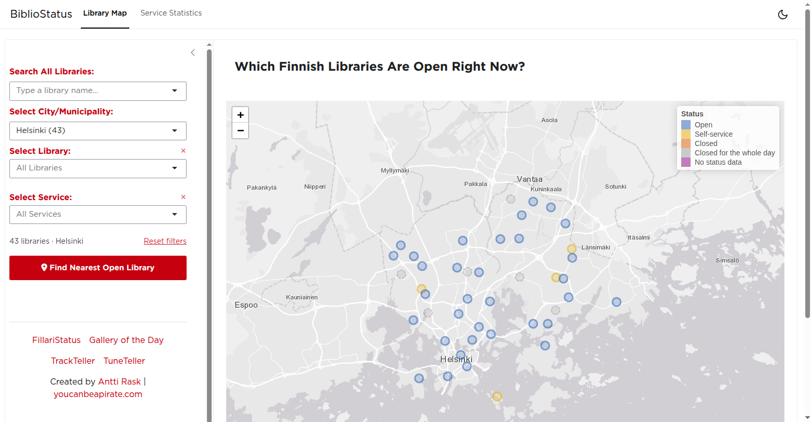

# 📚 BiblioStatus

**BiblioStatus** is a web app that shows the real-time opening status of Finnish public libraries on a map.

## 🔍 Features

- 🌍 Interactive map with open/self-service/closed statuses color-coded
- 📍 **Find Nearest Open Library** - Uses GPS to find 3-5 closest open libraries with distances
- 🔍 **Library Text Search** - Search libraries by name, auto-switches to their city and zooms to location
- 🏷️ **Service Filtering** - Filter map by library services (240+ unique services)
- 💎 **Service Badges** - Services displayed as visual badges for better readability
- 📊 **Service Statistics Dashboard** - Explore service distribution with city filtering and interactive charts
- 🗺️ **Get Directions** - One-click Google Maps navigation to any library
- 📱 Mobile-optimized layout with responsive sidebar and touch controls
- 📞 **Contact Information** - Phone and email links for each library
- 📅 **Complete Daily Schedule** - View all opening periods (e.g., "10:00-14:00 Open, 14:00-20:00 Self-service")
- 🌗 Dark mode toggle
- 🏢 City/municipality filter
- 🔗 Clickable popups with library information and links
- 📦 Data updated daily via GitHub Actions and stored in Turso (cloud SQLite) with historical preservation
- 📚 **Normalized Database** - Library services stored in proper relational structure (10,000+ service records)
- ✅ Automated URL monitoring with email alerts for broken links

## 📸 Screenshot



## 🚀 Live App

👉 [Try it here!](https://bibliostatus.youcanbeapirate.com)

## 🛠️ Project Structure

```bash
fetch_library_data.R        # Pulls data from Kirkanta API (v4) - daily schedules + weekly libraries
check_library_urls.R        # Validates all library URLs
R/
├── turso.R                 # Turso database helper functions
└── backfill_historical_data.R  # Backfill historical schedules
.github/workflows/
├── fetch_data.yml          # Daily schedules (2:00 AM UTC) + weekly libraries (Sunday)
├── check_library_urls.yml  # Daily URL validation (3:00 AM UTC)
└── deploy_shiny_app.yml    # Deploy to Google Cloud Run
app/
├── libraries.sqlite        # SQLite database fallback (updated nightly)
├── run.R                   # App entry point (host/port config)
├── server.R                # Server logic, search, filtering, geolocation, distance calculations
├── ui.R                    # UI with map, sidebar, search, service filtering, statistics tab
├── modules/
│   └── service_stats.R     # Service statistics dashboard module
└── www/
    ├── functions.R         # Database queries (Turso + SQLite fallback), service fetching
    ├── turso.R             # Turso API wrapper for Shiny app
    ├── styles.css          # Mobile-responsive CSS
    └── variables.R         # Color config for map markers
```

## 🔄 Data Pipeline

**Daily Schedule Updates** (2:00 AM UTC):

1. GitHub Actions runs `fetch_library_data.R` in "schedules" mode
2. Fetches today's opening hours from [Kirkanta API (v4)](https://api.kirjastot.fi/)
3. Writes to Turso (cloud SQLite) - preserves historical data
4. Updates `libraries.sqlite` as backup/fallback

**Weekly Library Metadata** (Sunday 2:00 AM UTC):

1. Runs `fetch_library_data.R` in "both" mode
2. Fetches library metadata (names, coordinates, URLs, contact info, services)
3. Applies 50+ manual URL corrections and 8 coordinate fixes
4. Extracts and normalizes library services to `library_services` table (10,000+ records, 240+ unique services)
5. Replaces library data in Turso (no historical versioning needed)

**App Data Access**:

- Primary: Reads from Turso database via HTTP API
- Fallback: Reads from `libraries.sqlite` if Turso unavailable
- Filters to today's schedules for real-time status display

## ✅ Data Quality & URL Monitoring

All library website URLs are automatically monitored daily:

- **Daily checks** run at 3:00 AM UTC (after data fetch)
- Validates all 720 library URLs for availability
- Email alerts sent if broken URLs are detected
- **Current status**: 95% working (683/720 libraries)
- Broken URLs are investigated and corrected within 24-48 hours

The monitoring workflow ensures users always have access to working library website links.

## 🔐 Deployment

This project is deployed as a Docker container on Google Cloud Run. See [DEPLOY.md](DEPLOY.md) for full instructions

Quick deploy:

```bash
./deploy.sh
```

## 🧪 Local Development

With Docker:

```bash
docker compose up --build
# Open http://localhost:8082
```

Or directly with R:

```r
renv::restore()
source("fetch_library_data.R")
shiny::runApp("app/")
```

## 📦 Required R Packages

- [dplyr](https://dplyr.tidyverse.org/) - Data manipulation
- [DT](https://rstudio.github.io/DT/) - Interactive data tables
- [ggplot2](https://ggplot2.tidyverse.org/) - Statistical graphics
- [here](https://here.r-lib.org/) - Path management
- [httr2](https://httr2.r-lib.org/) - Turso HTTP API client
- [jsonlite](https://github.com/jeroen/jsonlite) - JSON parsing
- [leaflet](https://rstudio.github.io/leaflet/) - Interactive maps
- [purrr](https://purrr.tidyverse.org/) - Functional programming
- [RSQLite](https://rsqlite.r-dbi.org/) - SQLite database interface
- [shiny](https://shiny.posit.co/r/getstarted/shiny-basics/lesson1/) - Web framework
- [shinyjs](https://deanattali.com/shinyjs/) - JavaScript operations
- [stringr](https://stringr.tidyverse.org/) - String manipulation
- [tidyr](https://tidyr.tidyverse.org/) - Data tidying

## 🗺️ Map Tiles

The basemap is Esri's World Light / Dark Gray canvas with a labels layer. It needs no API key, and the attribution ("Tiles © Esri — Esri, HERE, Garmin, © OpenStreetMap contributors, and the GIS user community") is shown on the map. The tiles are real only up to zoom 16, so tile requests are capped there and scaled up for closer views. (The app used Carto tiles with an API key until 2026-10-17.)

## 📄 License

- [MIT](https://opensource.org/license/mit)
